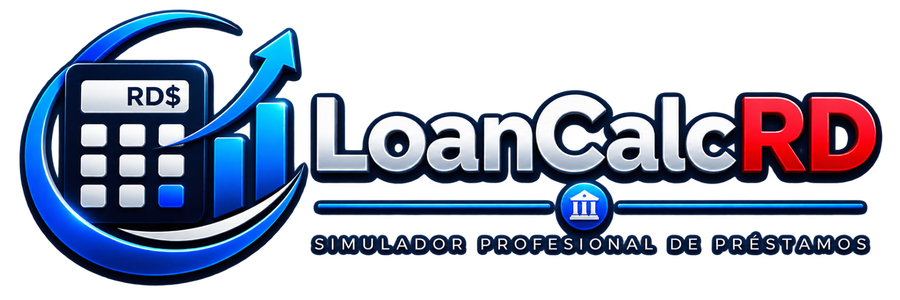

<p align="center">
  
</p>

<p align="center">
  <strong>Simulador financiero dominicano para calcular, analizar y comparar préstamos amortizados.</strong><br>
  Angular 21 · ASP.NET Core 10 · PostgreSQL 17
</p>

<p align="center">
  
  
  
  
  
</p>


> 🛡️ **Seguridad de dependencias:** ver [auditoría de npm (6 de noviembre de 2026)](docs/security-audit-2026-11-06.md). La versión histórica de Angular 9 fue retirada del árbol activo; permanece recuperable mediante el historial de Git.

---

## 📖 Descripción

**LoanCalc RD** es una aplicación web orientada al mercado dominicano que simula préstamos amortizados mediante el método francés. Calcula la cuota mensual, los intereses, el total pagado y el calendario completo de amortización, y permite analizar abonos extraordinarios, comparar escenarios y exportar reportes.

La **calculadora es gratuita, no requiere registro y se ejecuta completamente en el navegador**. Nombre, fecha de nacimiento y cédula son **opcionales** y solo se usan para personalizar los reportes PDF/Excel; nunca se envían a un servidor.

LoanCalc RD ofrece **simulaciones matemáticas, no asesoría financiera personalizada**. Las tasas y condiciones finales deben confirmarse con la entidad financiera.

El proyecto nació en **2020** como un ejercicio práctico propuesto por **Gerson Santos Mateo** para aprender Angular. En **2026** fue reconstruido como una aplicación moderna, responsive y accesible, y hoy evoluciona hacia una plataforma con cuentas de usuario (**LoanCalc RD v3**).

---

## 🧭 Estado de LoanCalc RD v3

La versión publicada en producción sigue siendo la **2.1.x** (calculadora pública). **La v3 no se ha publicado**: se desarrolla por fases.

| Fase | Alcance | Estado |
|---|---|:---:|
| 5 | Backend ASP.NET Core 10 + PostgreSQL 17 (Clean Architecture, EF Core, CI) | ✅ Fusionada |
| 6 | Cuentas, autenticación, seguridad de sesiones y renovación UX/UI | ✅ Fusionada (PR #57) |
| 7 | Dashboard personal, historial en nube, favoritos y comparador privado | ✅ Fusionada (PR #59) |
| 8 | Publicación de API, base de datos, SMTP y dominio definitivos | ⏳ Pendiente |

### Calculadora pública vs. funciones con cuenta

| Función | Sin cuenta | Con cuenta |
|---|:---:|:---:|
| Simulación, amortización, abonos y estrategias | ✅ | ✅ |
| Comparador de escenarios, Dashboard y LoanCalc Score | ✅ | ✅ |
| Exportación PDF/Excel y compartir | ✅ | ✅ |
| Historial local (solo en el dispositivo) | ✅ | ✅ |
| Correo verificado, sesiones revocables y cambio de contraseña | — | ✅ (Fase 6) |
| Simulaciones privadas guardadas en la nube | — | ✅ Implementadas en código; habilitación pendiente de Fase 8 |

> En el build de producción de Cloudflare Pages las pantallas de cuenta están **desactivadas** (`features.accounts = false`) hasta que la API y el SMTP estén desplegados en la Fase 8. En desarrollo local están activas.

---

## 🛠️ Stack

### Frontend — `calculadora-prestamos/`

- **Angular 21** (componentes standalone, signals, control flow, rutas lazy) y **TypeScript 5.9**.
- **Bootstrap 5** + **Bootstrap Icons**; sistema de tokens CSS propio. Interfaz **exclusivamente clara**.
- **jsPDF / jsPDF AutoTable / QRCode** para reportes; **SpreadsheetML** para Excel.
- **Vitest** (pruebas unitarias y de componentes) y **Playwright + axe-core** (E2E y accesibilidad).

### Backend — `backend/`

- **ASP.NET Core 10** (Minimal APIs organizadas por módulos) con **Clean Architecture**: `Domain`, `Application`, `Infrastructure`, `Api`.
- **Entity Framework Core 10** + **Npgsql** sobre **PostgreSQL 17**.
- **ASP.NET Core Identity** (usuarios GUID, hash de contraseñas, bloqueo, confirmación de correo).
- **JWT Bearer** de corta duración + **refresh tokens rotatorios** en cookie HttpOnly.
- **xUnit** + `WebApplicationFactory` contra PostgreSQL real; **Docker Compose** para desarrollo.

### Calidad

- **GitHub Actions:** `LoanCalc RD CI` (pruebas, build y E2E del frontend) y `LoanCalc RD Backend CI` (build, migraciones, actualización desde Fase 5, pruebas, auditoría NuGet).

---

## ☁️ Fase 7 — plataforma financiera privada (integrada, aún sin activar)

El PR #59 integró en `master` una interfaz Angular protegida bajo `/account/simulations`:

- Dashboard privado con capital **simulado** (no deuda bancaria real), tasas promedio, cantidad de escenarios y favoritos.
- Historial en la nube: filtrar, buscar, ordenar, renombrar, marcar favoritos, eliminar y abrir los resultados para reconstruir la amortización localmente.
- Comparador de dos simulaciones guardadas (cuota mensual, intereses, total y plazo).
- Guardado explícito desde la página de resultados, solo cuando se ha iniciado sesión.
- Importación **voluntaria** del historial local y deduplicación por condiciones financieras.
- El backend de la Fase 6 mantiene los permisos por propietario mediante JWT: ningún `userId` enviado desde Angular concede acceso.
- Nunca se envían nombre, cédula ni fecha de nacimiento en la API de simulaciones.
- Las funciones privadas permanecen **ocultas y desactivadas en Cloudflare Pages** (`features.accounts = false`) hasta que la API, PostgreSQL y SMTP estén operativos en Fase 8.

Consulta [la guía de Fase 7](docs/PHASE7.md). Las pruebas E2E del frontend utilizan una API simulada; la verificación real del flujo entre dispositivos depende de desplegar el backend.

---

## 📋 Páginas legales y soporte

El sitio público mantiene accesibles las páginas [Política de Privacidad](https://loancalcrd.pages.dev/privacy), [Términos de Uso](https://loancalcrd.pages.dev/terms) y [Contacto](https://loancalcrd.pages.dev/contact), enlazadas en el pie de página y en el sitemap.

- **Privacidad:** información sobre el historial local, los datos personales opcionales, Cloudflare y AdSense (pendiente de activación de anuncios).
- **Términos:** simulación educativa, límites de los cálculos y uso responsable.
- **Contacto:** soporte y sugerencias por GitHub Issues, que es público. No introducir allí información personal o financiera sensible. No hay formulario privado de contacto mientras no se publique un canal seguro.

Los textos son informativos y requieren revisión jurídica antes de utilizar funcionalidades con cuentas o nuevas operaciones financieras.

---

## 💰 Google AdSense (integración preparada)

LoanCalc RD puede verificar la propiedad del dominio público `loancalcrd.pages.dev` mediante una metaetiqueta y un archivo `ads.txt` generados durante el build de Cloudflare Pages, cuando se indique el ID de editor real.

**Los anuncios están desactivados por defecto**. Se habilitarán únicamente después de la aprobación de este sitio en AdSense y de configurar los controles de consentimiento aplicables. La calculadora gratuita y la vista previa de WhatsApp no dependen de la publicidad.

Consulta [docs/ADSENSE-CLOUDFLARE.md](docs/ADSENSE-CLOUDFLARE.md) para la configuración de variables y el proceso de revisión del sitio.

---

## ✨ Funcionalidades

### 💰 Simulación del préstamo

- ✅ Préstamos personales, hipotecarios, de vehículo, educativos y comerciales.
- ✅ Solo datos financieros obligatorios: monto, tipo, tasa anual (0–100 %) y plazo (1–600 meses).
- ✅ Plazos rápidos (12–240 meses), equivalencia en años y tasa mensual equivalente.
- ✅ Validación contextual por campo con mensajes accesibles.
- ✅ Cuota mensual, capital, intereses, total a pagar y calendario completo.
- ✅ Préstamos con tasa de interés igual a cero.

### 👤 Datos para el reporte (opcionales)

- ✅ Nombre, apellido y fecha de nacimiento (cálculo de edad).
- ✅ Cédula con formato `000-0000000-0` y validación Luhn **solo si se introduce**.
- ✅ No se envían a la API ni son necesarios para simular.

### 💸 Abonos extraordinarios

- ✅ Abono único o mensual recurrente.
- ✅ Estrategias para reducir el plazo o recalcular la cuota.
- ✅ Intereses y meses ahorrados, total abonado y tabla especializada.

### 📊 Análisis financiero

- ✅ Dashboard financiero, distribución capital/interés y evolución del balance.
- ✅ **LoanCalc Score** (A+ a D según la proporción de intereses sobre el capital).
- ✅ Comparador de escenarios por entidad (tasas introducidas por el usuario).
- ✅ Recomendaciones automáticas con aviso explícito de que no son asesoría personalizada.
- ✅ Montos en formato único **RD$ 1,234.56** en pantalla, PDF y Excel.

### 📤 Exportación y uso compartido

- ✅ PDF del préstamo y del escenario de abonos (logo, número de reporte, QR, paginación).
- ✅ Libro Excel con hojas de resumen, comparación y amortización.
- ✅ Compartir por WhatsApp, Facebook y LinkedIn; copiar resumen.
- ✅ Historial local de hasta 20 simulaciones.

### 🔐 Cuentas (Fase 6)

- ✅ Registro con política de contraseñas robusta y checklist en vivo.
- ✅ Confirmación de correo con enlace temporal de un solo uso y reenvío.
- ✅ Inicio de sesión con bloqueo temporal tras intentos fallidos.
- ✅ Recuperación y cambio de contraseña (revoca todas las sesiones anteriores).
- ✅ Cierre de sesión en el dispositivo o en todos los dispositivos.
- ✅ Recuperación automática de la sesión al recargar y renovación transparente.
- ✅ Área privada protegida por guard.

### ♿ Accesibilidad y responsive

- ✅ Enlace "Saltar al contenido", navegación por teclado y foco visible.
- ✅ Etiquetas, `aria-invalid`, `aria-describedby` y regiones `aria-live` en formularios.
- ✅ Objetivos táctiles ≥ 44 px, sin desplazamiento horizontal en móvil.
- ✅ Respeto de `prefers-reduced-motion`.
- ✅ Verificación automática WCAG 2.2 A/AA con axe-core en E2E.

---

## 🔒 Seguridad (resumen)

- El **access token** (JWT HS256, 15 min) vive **solo en memoria**; nunca en `localStorage` ni `sessionStorage`.
- El **refresh token** viaja en una cookie `HttpOnly`, `Path=/api/v1/auth`, `SameSite=Strict` (configurable a `None`+`Secure` para dominios distintos). En base de datos solo se guarda su **hash SHA-256**.
- **Rotación atómica de un solo uso**: reutilizar un token consumido revoca la sesión completa; dos renovaciones simultáneas con el mismo token nunca producen dos tokens válidos (probado contra PostgreSQL).
- Cada petición autenticada verifica que la **sesión siga activa**: logout, logout global, cambio o restablecimiento de contraseña y eliminación del usuario invalidan el JWT de inmediato.
- **Sin enumeración de usuarios**: respuestas neutras en registro, reenvío y recuperación; cola de correo en segundo plano y tiempos de login igualados.
- **CSRF**: encabezado no simple obligatorio + validación de `Origin`/`Referer` contra la lista permitida + CORS explícito con credenciales.
- **Rate limiting** por política (login, registro, verificación, recuperación, sesión y API) con `Retry-After`.
- Problem Details con **códigos estables** y sin detalles internos; encabezados de seguridad y HSTS.
- Las simulaciones privadas se filtran **siempre** por el usuario del JWT; nunca se acepta un `userId` del cliente.

Detalles completos en [`backend/README.md`](backend/README.md) y [`docs/DEPLOYMENT.md`](docs/DEPLOYMENT.md).

---

## 📂 Estructura principal

```text
CalculadoraPrestamos
├── calculadora-prestamos          # Frontend Angular
│   ├── src/app
│   │   ├── core
│   │   │   ├── config             # APP_CONFIG (URL de API y feature flags por entorno)
│   │   │   ├── formatting         # Formato RD$
│   │   │   ├── guards             # authGuard, accountsEnabledGuard
│   │   │   ├── interceptors       # authInterceptor (Bearer, CSRF, renovación única)
│   │   │   ├── models
│   │   │   ├── services           # AuthService, LoanApiService, LoanCalculatorService
│   │   │   └── validators         # Cédula, política de contraseñas
│   │   ├── pages                  # home, calculator, results, account, account-security
│   │   └── shared                 # header, footer
│   ├── src/environments           # environment.ts / environment.production.ts
│   └── e2e                        # Playwright
├── backend                        # API ASP.NET Core 10 (ver backend/README.md)
├── docs                           # Guías de despliegue, seguridad y fases
├── .github                        # CI/CD, auditorías y Dependabot
├── CHANGELOG.md
└── README.md
```

---

## 🚀 Ejecución local

### Frontend

```bash
cd calculadora-prestamos
npm ci
npm start                 # http://localhost:4200 (cuentas activas, API en http://localhost:5000)
npm run test:ci           # pruebas unitarias y de componentes (Vitest)
npm run e2e               # E2E con Playwright (API de cuentas simulada)
npm run build             # build de producción (cuentas desactivadas)
npm run e2e:smoke         # smoke del build de producción (como se publica en Cloudflare Pages)
```

La calculadora funciona aunque la API no esté ejecutándose.

### Backend

Requiere .NET SDK 10 y Docker. Guía completa en [`backend/README.md`](backend/README.md):

```powershell
cd backend
docker compose up -d postgres
# Configura ConnectionStrings__LoanCalcDb, Jwt__SigningKey y (opcional) Smtp__* — ver backend/README.md
dotnet ef database update --project src/LoanCalcRD.Infrastructure/LoanCalcRD.Infrastructure.csproj --startup-project src/LoanCalcRD.Api/LoanCalcRD.Api.csproj
dotnet run --project src/LoanCalcRD.Api/LoanCalcRD.Api.csproj --urls http://localhost:5000
```

---

## 🌐 Despliegue continuo

El frontend se publica en **https://loancalcrd.pages.dev** mediante Cloudflare Pages conectado a GitHub:

1. Cada Pull Request a `master` ejecuta CI. Cloudflare puede generar un **Preview Deployment** si está activado para la rama.
2. Tras fusionar en `master`, Cloudflare Pages debería compilar y publicar automáticamente (requiere que `master` sea la rama de producción y estén activos los despliegues automáticos).
3. El workflow **LoanCalc RD Cloudflare Verify** espera el commit de producción y comprueba la respuesta HTTP, Open Graph y la imagen. La confirmación real depende del resultado del workflow.
4. El build mantiene las cuentas desactivadas hasta publicar API y SMTP (Fase 8).

Configuración, rollback y diagnóstico: [`docs/DEPLOYMENT.md`](docs/DEPLOYMENT.md).

---

## 🧪 Calidad y validación

| Suite | Herramienta | Alcance |
|---|---|---|
| Frontend unitarias/componentes | Vitest | Motor financiero, cédula, formato RD$, AuthService, interceptor, guards, formularios de cuenta y calculadora |
| Frontend E2E | Playwright + axe-core | Flujo público completo, navegación por teclado, WCAG A/AA, flujo de cuenta con **API simulada** |
| Backend | xUnit + PostgreSQL 17 real | Registro, login, bloqueo, confirmación, recuperación, cambio de contraseña, JWT alterados/expirados, rotación y reutilización, renovaciones concurrentes, logout, logout global, CSRF, cookies, rate limiting, IDOR, migraciones y persistencia |
| CI backend | GitHub Actions | Actualización desde una base de Fase 5 con datos y rollback, auditoría de vulnerabilidades NuGet |

> Las pruebas usan un **emisor de correo simulado**: validan tokens y enlaces, no la entrega real por un proveedor SMTP.

---

## ⚠️ Limitaciones conocidas

- La entrega real de correos requiere configurar un proveedor SMTP (pendiente de Fase 8).
- La cola de correo es en memoria: un reinicio puede perder mensajes en tránsito (el usuario puede reenviarlos).
- La interfaz privada está desarrollada, pero no estará accesible en el sitio público hasta desplegar API, PostgreSQL y SMTP en Fase 8.
- La tabla de simulaciones mantiene `UserId` sin clave foránea a `AspNetUsers`; la API aplica autorización por propietario. La integridad referencial de datos heredados debe evaluarse antes del lanzamiento público.

---

## 💡 Origen del proyecto

LoanCalc RD fue inspirado en el siguiente ejercicio propuesto en 2020 por **Gerson Santos Mateo**:

> “El ejercicio después que tengas todo eso estudiado será hacer una calculadora de préstamos amortizada, donde el usuario pueda insertar la cantidad que desea prestada, seleccionar los años que tendrá el préstamo y por último seleccionar qué tipo de préstamo será: hipotecario, automotriz o personal.”

---

## 📜 Licencia y atribuciones

LoanCalc RD se distribuye bajo la **Licencia MIT**. Consulta [`LICENSE`](LICENSE).

La validación de cédula mediante Luhn fue adaptada de la implementación pública de **OGTIC Cuenta Única Registry**, también licenciada bajo MIT. Consulta [`THIRD_PARTY_NOTICES.md`](THIRD_PARTY_NOTICES.md).

---

## 👨‍💻 Autor

**Francis Jairo Matías Rosario**

Idea original del ejercicio: **Gerson Santos Mateo**

<p align="center">
  LoanCalc RD · 2020 — Presente
</p>
